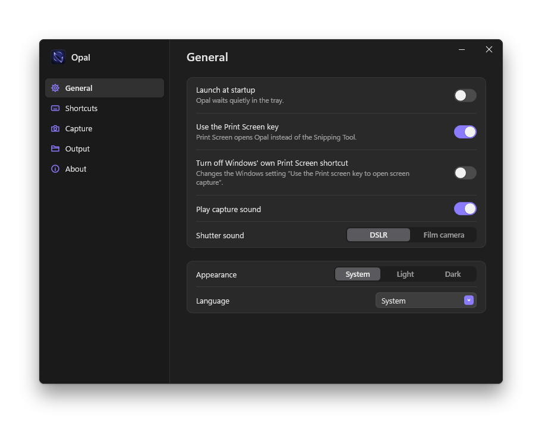
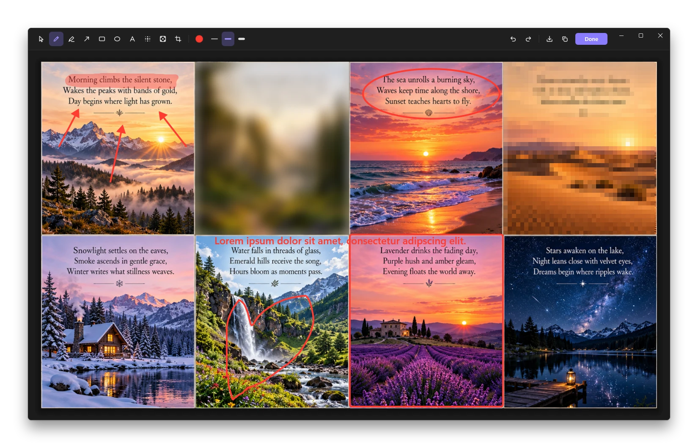

<p align="center"></p>

# Opal

macOS-style screenshots for Windows. Press Print Screen, pick a window and get a clean rounded-corner shot with a soft shadow, or pick a card or button inside an app and let Opal find its exact edges and corner radius.

It is a single `Opal.exe` of under 1 MB that waits in the tray.

<p align="center"></p>
<p align="center"></p>

## Install

Download `Opal-<version>.exe` from the latest release and run it, or build it yourself:

```bash
cmake --preset x64
cmake --build --preset x64-release
```

The program is written to `build/Release/Opal.exe`. On its first start Opal adds itself to the programs that start with Windows and opens its settings; both can be changed later. Run the file again while Opal is running to open the settings.

## Capturing

Press Print Screen to open the capture bar at the top of the screen. The screen freezes while you choose, so menus and hover states stay in the shot.

| Mode | How it works |
| --- | --- |
| Screen | Click a screen to capture all of it. The shortcut captures the screen under the mouse pointer right away. |
| Window | Hover a window to highlight it, click to capture it. The window's own content is captured, even where other windows cover it, with Windows 11's rounded corners cut out exactly and a macOS-style shadow added. Hold Alt while clicking to leave the shadow out. |
| Region | Drag a rectangle. A magnifier shows the pixel under the pointer, its coordinates and its color. Shift keeps the selection square, holding Space while dragging moves it. From the bar, the selection keeps eight handles, moves with the arrow keys and is remembered for next time. |
| Element | Hover any part of an app to highlight the element under the pointer, scroll or press Tab to move to a larger or smaller element, and click to capture it. You can also drag roughly around something; Opal snaps the selection to the nearest edges. The corner radius is measured and the capture is cut to match. Hold Alt for the raw selection without snapping. |

While capturing, Esc or a right click cancels, Enter captures the current selection, and from the bar the keys 1 to 4 switch modes. The **Options** menu on the bar chooses where captures go, a 5 or 10 second timer, and whether the floating thumbnail, the mouse pointer, the window shadow and the magnifier are shown.

### Shortcuts

| Shortcut | Action |
| --- | --- |
| `PrintScreen` | Show the capture bar |
| `Ctrl+Shift+3` | Capture the screen |
| `Ctrl+Shift+4` | Capture a region (Space switches to window mode) |
| `Ctrl+Shift+5` | Capture a window |
| `Ctrl+Shift+6` | Capture an element |

Every shortcut can be changed or cleared on the **Shortcuts** page of the settings. Opal also accepts these arguments, and passes them to the copy that is already running: `--bar`, `--region`, `--window`, `--element`, `--screen`, `--settings`, `--quit`.

## After a capture

A thumbnail of the capture slides in at the bottom right and goes away after a few seconds.

- **Click** it to open the markup editor.
- **Drag** it into any app or folder to drop the image there as a PNG file.
- **Swipe** it to the right to dismiss it.
- **Right-click** it to copy, open the markup editor, show the file in its folder, save a copy elsewhere or delete it.

The markup editor has a pen, a highlighter, arrows, rectangles, ellipses, text, blur, pixelate and crop, with eight colors and three stroke widths, undo and redo. **Done** writes the result back to the same file and to the clipboard. Shortcuts: V, P, H, A, R, O, T, B, X and C pick the tools in toolbar order, Ctrl+Z and Ctrl+Y undo and redo, Ctrl+C copies, Ctrl+S saves a copy, Delete removes the selected markup.

Captures are copied to the clipboard and saved to `Pictures\Opal` as PNG, depending on the settings. The clipboard gets a PNG, a bitmap with transparency and a bitmap flattened on white, so each app can take the format it understands; transparent corners and shadows survive in apps that read PNG or transparent bitmaps.

## Settings

The settings window opens from the tray menu. Changes apply right away and are saved to `%APPDATA%\Opal\settings.ini`, which can also be edited by hand while Opal is closed.

| Key | Default | Meaning |
| --- | --- | --- |
| `General.launchAtStartup` | `1` | Start Opal with Windows |
| `General.usePrintScreen` | `1` | Print Screen opens Opal instead of the Snipping Tool |
| `General.playSound` | `1` | Play a shutter sound after a capture |
| `General.shutterSound` | `modern` | `modern` (DSLR) or `vintage` (film camera) |
| `General.language` | `auto` | `auto` follows Windows; `en` or `tr` |
| `General.theme` | `system` | `system`, `light` or `dark` |
| `Hotkeys.bar`, `screen`, `region`, `window`, `element` | see [Shortcuts](#shortcuts) | A shortcut such as `Ctrl+Shift+4`, or empty for none |
| `Capture.windowShadow` | `1` | Add the shadow to window captures |
| `Capture.showPointer` | `0` | Include the mouse pointer |
| `Capture.showLoupe` | `1` | Show the magnifier in region and element mode |
| `Capture.timer` | `0` | Self-timer for captures from the bar: `0`, `5` or `10` seconds |
| `Capture.snapEdges` | `1` | Snap element selections to the nearest edges |
| `Capture.autoCorners` | `1` | Measure corner radii and cut element captures to match |
| `Capture.elementShadow` | `0` | Add a shadow to element captures |
| `Thumbnail.show` | `1` | Show the floating thumbnail |
| `Thumbnail.seconds` | `5` | How long the thumbnail stays, from 2 to 30 seconds |
| `Output.clipboard` | `1` | Copy captures to the clipboard |
| `Output.file` | `1` | Save captures as files |
| `Output.folder` | empty | Folder for saved captures; empty means `Pictures\Opal` |
| `Output.prefix` | `Opal` | Start of the file name, followed by the date and time |

The **General** page also has a switch for Windows' own "Use the Print screen key to open screen capture" setting. Opal takes the key first either way; the switch only changes that Windows setting.

## Good to know

- When a program running as administrator has the keyboard focus, Windows does not pass key presses to programs without administrator rights, so Opal's shortcuts do nothing until focus moves elsewhere or Opal itself runs as administrator.
- Element mode reads the app's accessibility tree, which takes from a few milliseconds to about a second for large web pages. Until it is ready, dragging around the element with edge snapping still works.
- Apps that draw everything themselves and expose no accessibility tree, such as many games, only offer the whole window as an element.
- If a window cannot be captured on its own, Opal falls back to the frozen screen pixels inside the window's bounds.
- The thumbnail and the timer are left out of screenshots and screen sharing. Set the environment variable `OPAL_SHOW_IN_CAPTURES` to `1` before starting Opal to keep them visible, for example when testing with screen recording tools.
- In the tray Opal uses about 14 MB of memory. The graphics device is created for a capture and released after 20 idle seconds.
- Opal writes a log to `%LOCALAPPDATA%\Opal\opal.log`, and after a crash a `crash.dmp` next to it.
- The shutter sounds are [DSLR Shutter fast 006](https://freesound.org/s/539136/) by ristooooo1 and [Werra](https://freesound.org/s/409093/) by hmilleo, both released under CC0.

## Development

```bash
cmake --preset x64
cmake --build --preset x64-debug
ctest --preset x64-debug
```

Building needs Visual Studio 2026 with the C++ desktop workload and the Windows SDK 10.0.22621 or newer. The version number comes from `project()` in `CMakeLists.txt` and can be overridden with `-DOPAL_VERSION=1.2.3`.

The app icon is built from `res/logo.svg`. `python tools/make_icon.py --render` renders the SVG with Edge or Chrome into `res/logo.png` and builds `res/opal.ico` and `res/opal.png` from it; without `--render` it reuses the existing `res/logo.png`. It needs Pillow.

Interface strings, in English and Turkish, are in `src/core/Strings.h`. How the pieces fit together is described in [docs/architecture.md](docs/architecture.md). Every push to `main` publishes a new release.

## License

Free to use, modify and redistribute, as long as the original author stays credited and the project is not presented as someone else's own. See [LICENSE](LICENSE).
